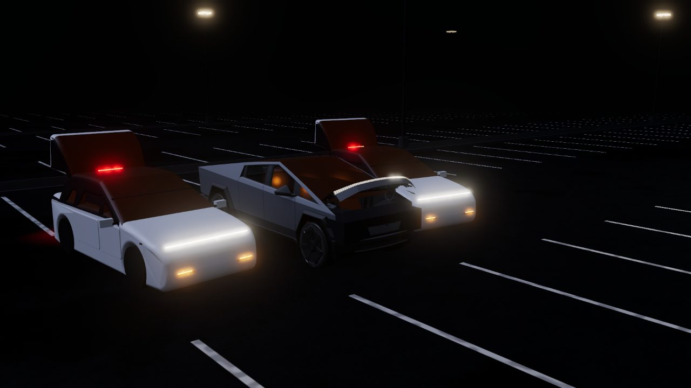

# Carreography

A light show for one to five Teslas, made from your song in your browser. You line up the cars as the
crowd will see them, drop in a song, and Carreography listens to it (the beat, the notes, the loudness,
the shape of the song, and the lyrics when it can find them) and choreographs every car's lights and
motors to the music. The lineup plays as one instrument: notes run across the cars like a keyboard, the
beat thumps through every headlight, builds sweep in from the ends and land on the peak, and the
liftgates, frunks, windows, mirrors and charge ports move on the big moments. You watch it on Tesla's own
3D models before it goes anywhere near a car.

**[matthewhager.github.io/carreography](https://matthewhager.github.io/carreography/)**

## Make a show

1. **Pick the cars**, from the crowd's left to right, and a paint for each.
2. **Drop in a song**: MP3, WAV, FLAC or M4A.
3. **Make the show.** It takes from about ten seconds to a minute or so, depending on the song, the
   browser and the device. Then watch it in 3D.
4. **Download the ZIP.** It has a folder for each car, named after its place (`Car1_ModelY_Left`), with
   that car's `LightShow` folder inside. The files differ from car to car.
5. **Put each car's `LightShow` folder on its own USB drive**, at the top level of a drive formatted
   exFAT or FAT32.
6. **Plug the drive into the car** and open **Toybox → Light Show**. To play several cars together,
   schedule the same start time on each of them in the Tesla app.

Keep people clear of the cars: liftgates, frunks, mirrors, windows and a Model X's doors move during the
show. The music plays from the cabin speakers, so the windows go down and stay down; close them
afterwards.

## Cars

Every car Tesla supports for light shows that has a model in the Tesla app:

| Car | |
|---|---|
| Model S | 2021 and later |
| Model 3 | 2017–2023, and 2024 and later |
| Model X | 2021 and later (its falcon doors dance on the biggest peak) |
| Model Y | 2020–2024; 2025 and later, Premium / Performance and Standard; Model Y L |
| Cybertruck | |

Tesla hasn't documented the 2025+ Model Y's lamps; its light bar follows what owners found by testing on
their cars ([how it works](docs/HOW_IT_WORKS.md#the-2025-model-ys-lamps)).

## Browsers

A recent Chrome, Edge, Firefox or Safari makes shows, on a computer, an iPad or an iPhone, in about
10–40 s for a 2½-minute song. The listening runs on the GPU where it can and falls back by itself. Times,
memory and the details are in [How it works](docs/HOW_IT_WORKS.md#browsers).

## Privacy

The song never leaves your device: the listening, the choreography and the preview all run in the page.
To find the lyrics, the song's artist, title and length (from its tags, or its file name) are sent to
[LRCLIB](https://lrclib.net). The site downloads the listening models and Tesla's car models once, and the
browser keeps them.

## More

- [How it works](docs/HOW_IT_WORKS.md): how a song becomes a show.
- [The moves](MOVES.md): every move, what it looks like and when it's used.
- [Contributing](CONTRIBUTING.md): developing the app, adding a move or a car.
- [Sources and credits](docs/SOURCES.md).

Use recordings you have the right to use. The show files are yours.

## Licence

[AGPL-3.0](LICENSE), because the 3D preview is adapted from
[Tesla Lightshow Studio](https://github.com/nathanjgrace/tesla-lightshow-studio) by Nathan Grace
(AGPL-3.0). The car models are Tesla's, from the Tesla app.

Not affiliated with Tesla. Light shows move real parts of real cars: watch the space around them.
